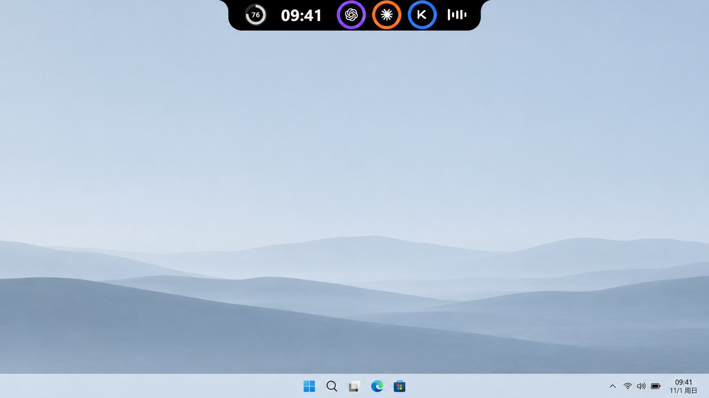
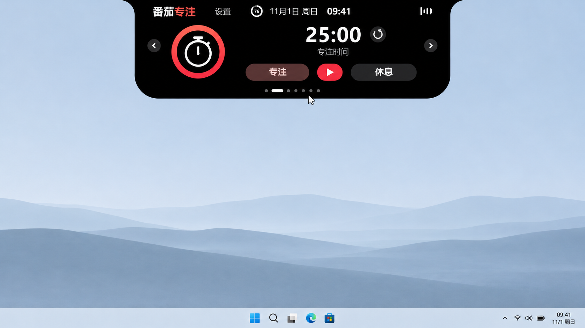
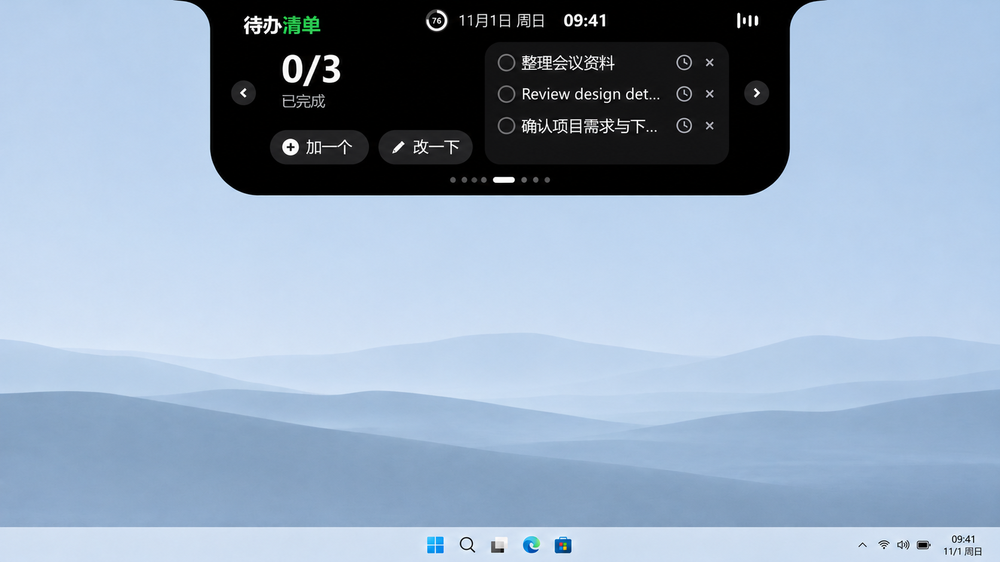
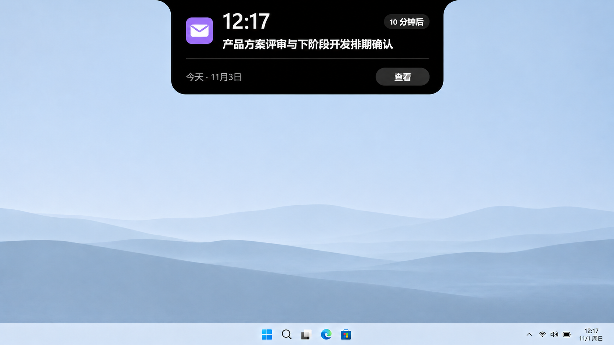

# Nahfi IP Island

基于岛仔 Daozai 的 Rust + egui Windows 桌面灵动岛。当前版本 **0.6.51**。

## 下载 Windows x64

- [直接下载 EXE](https://github.com/zhangweig/nahfi-ip-island/releases/download/v0.6.51/Nahfi-IP-Island.exe)
- [完整 ZIP（含使用说明和许可证）](https://github.com/zhangweig/nahfi-ip-island/releases/download/v0.6.51/Daozai-v0.6.51-windows-x64.zip)
- [版本说明与 SHA-256](downloads/v0.6.51/RELEASE_NOTES.md)

## 功能页面

音乐、专注、饮水、置物架、待办、邮箱、AI 额度、日程、**键鼠电量**和 **IP Monitor** 是同级页面，可通过左右箭头、滚轮和底部页码切换，在「设置 → 页面管理」中开关及排序。升级会保留旧页面顺序与开关，新页面追加在末尾。

### 键鼠电量

持续显示已连接蓝牙键盘和鼠标的名称、电量百分比和电量条，每两秒更新。低于或等于 20% 用黄色标示；设备未向 Windows 上报电量时明确显示“电量未知”。支持多设备分页。

蓝牙读取 Windows 通用电量属性。0.6.49 增加以下 **USB 2.4G 实验性适配**，每 15 秒查询：

| 型号 | 接收器匹配 | 状态 |
| --- | --- | --- |
| KZZI K75 Lite | `3554:FA09`，接口 1 / FF02:0002，额外核对设备身份 | 协议已接入，公开参考仅确认连接检测，电量需实机验证 |
| VXE R1 系列 | `3554:F58A` 或 `373B:1085`，接口 1 / FF02:0002 | 协议已接入；不同子型号、接收器和固件需实机验证 |

只发送已知读取请求，不修改 DPI、灯效、配对或固件。接收器在但设备休眠、驱动占用、响应校验失败时显示未知，不推测百分比。建议退出官方驱动、唤醒设备后等待 15 秒。其他接收器不会被探测。详见 [USB 适配说明](docs/USB_BATTERY.md)。

### IP Monitor 与隐私

IP Monitor 已独立成同级功能页，不再覆盖音乐主页面，也不占用收起药丸。

- 默认打码公网 IP：IPv4 例如 `203.***.***.7`，IPv6 仅显示首段。
- 点击“显示”主动查看，10 秒后自动隐藏；切页、收起后隐藏。
- 只有点击“复制完整 IP”才会把原文放入剪贴板。
- 显示国家、请求路径、检测状态与时间，支持手动刷新。
- 页面右上角设置中可配置本机 HTTP / mixed 代理端口，例 `7890`；`0` 为不指定代理。刷新间隔为 15–3600 秒，默认 60 秒。
- 代理请求失败不回退直连，旧结果明确标记；查询在后台运行，8 秒超时。

查询接口为 `https://ipwho.is/`，每次请求会向该服务暴露出口 IP。结果仅代表访问该接口的出口，不代表所有网站，也不是 Clash 当前节点名称。不支持 SOCKS-only 端口或代理认证。

### 4K / 高 DPI

默认自动结合屏幕物理分辨率和 Windows DPI 决定界面缩放：4K 屏在 Windows 100% 下放大至约 2×，Windows 已设为 200% 时不再重复放大。显示设置或 DPI 改变时重新计算窗口尺寸、顶部居中位置和原生鼠标命中区域。

「设置 → 常规 → 屏幕与缩放」可关闭自动模式，设置 Windows DPI 基础上的额外缩放（75%–250%），立即生效。

## 构建与验证

Windows 安装 Rust stable 和 Visual Studio C++ Build Tools，在仓库根目录运行：

```powershell
cargo test --locked --all-targets --features record -- --test-threads=1
cargo build --locked --release --bin daozai
.\target\release\daozai.exe
```

新增测试覆盖页面导航、旧配置迁移、键鼠电量与未知状态、IP 打码/复制/超时和多 DPI 交互。Linux 全量测试中两个原始上游已复现的失败为日历字体间距、Windows 凭据保存；排除后其余测试通过。Windows 交叉编译成功不代表已在 Windows 实机验证，仍需实机核验具体设备及混合 DPI 多屏行为。

## 来源与许可证

上游基线：[Renly1994/xiaotang-daozai](https://github.com/Renly1994/xiaotang-daozai)，提交 `0d52f42cacc145d6ec7e32be8414b7944475cd63`（0.6.47）。保留 MIT [许可证](LICENSE)和第三方声明。

国旗来自 `country-flag-icons` 1.6.20（MIT），按 npm 发布元数据的 SHA-512 校验后本地打包，见 [assets/flags/LICENSE](assets/flags/LICENSE)。

下面保留上游文档供参考；其中上游下载地址不包含本分支的改动。

---

<div align="center">


# 岛仔 · Daozai

**让重要的信息，轻轻出现在屏幕顶部。**

Windows 桌面伙伴 · 音乐与歌词 · 邮件验证码 · 日程提醒 · AI 额度

[](https://github.com/Renly1994/xiaotang-daozai/releases/latest)
[](#安装与更新)
[](LICENSE)
[](https://github.com/Renly1994/xiaotang-daozai/actions/workflows/ci.yml)

[下载 Windows 版](https://github.com/Renly1994/xiaotang-daozai/releases/latest) · [使用指南](docs/USAGE.md) · [更新记录](CHANGELOG.md) · [反馈问题](https://github.com/Renly1994/xiaotang-daozai/issues)

</div>



## 一个小岛，装下桌面上的小事

岛仔贴在屏幕顶部，收起时是一条小刘海。鼠标靠近时展开，离开时收起；需要处理的信息出现时再提醒你。它由 Rust 和 egui 构建，不依赖 Electron。

| 功能 | 可以做什么 |
| --- | --- |
| 桌面伙伴 | 会眨眼、打盹、喝水，也会拿起麦克风跟着音乐唱；可切换极简模式 |
| 音乐与歌词 | 读取 Windows 媒体会话，控制播放、切歌、进度；支持岛上单行歌词 |
| 专注与饮水 | 专注／休息计时、饮水目标、提醒时段、快捷记录与撤销 |
| 文件置物架 | 拖入临时收集，打开或定位原文件，拖出到其他应用；移除记录不删除原文件 |
| 待办 | 添加、编辑、完成任务；用日期和时间选择器设置可选提醒 |
| 邮件 | 多账号收信、验证码来源识别与点击复制、正文阅读、默认浏览器打开链接 |
| 日程 | 月历和当日安排；合并工作日历与邮件邀请，支持全天、跨天、重复日程及单次修改／取消 |
| AI 额度 | Codex、Claude、Kimi、Grok Bot、Gemini；多账号、常驻圆环、重置时间和自选配色 |
| 系统提示 | 电源、电量、网络、音量、大写锁定、输入语言和蓝牙设备状态 |

### 专注工作，也记得休息和喝水

开始一段专注时间，在专注与休息之间切换；饮水面板记录当天进度，可以设置目标和提醒时段。



### 待办随手记，文件临时放

把待办加到屏幕顶部，完成后勾选；需要提醒的事项可以单独设置日期和时间。置物架则用来临时收集文件，支持打开、定位原文件和拖出到其他应用。



### AI 额度，抬眼就能看见

收起时用圆环显示额度，展开后查看账号与重置时间。支持多账号，可选择常驻展示的服务和配色。

各服务与订阅的连接方式及可用性见下方「连接哪些服务」。

### 邮件和日程，放在同一条时间线上



- 正式日历邀请自动进入日程；普通邮件正文出现日期不会自动创建日程。
- 可忽略某条邮件日程，停止显示和提醒；邮件保留，可从详情恢复。
- 滚轮只滚动下方列表；大卡片保持当前选择，点击其他日程才切换详情。
- 同一场日程使用 UID 与开始时间去重，工作日历和邮件来源可以同时标识。

以上为基于演示界面制作的 AI 产品展示图，展示收起、展开与提醒状态，界面细节以实际版本为准。[查看原始界面截图](docs/images)。

## 安装与更新

1. 前往 [Releases](https://github.com/Renly1994/xiaotang-daozai/releases/latest)，下载安装版 `Daozai-Setup-v0.6.40-x64.exe`。
2. 双击安装器，可修改安装位置、选择是否创建桌面快捷方式和开机自启，再点击「一键安装」。桌面快捷方式默认勾选，首次安装默认不开机自启；无需解压。
3. 安装完成后打开「岛仔」，也可从桌面快捷方式启动。在托盘菜单打开设置，选择需要的功能。

需要免安装使用时，下载 `Daozai-v0.6.40-windows-x64.zip` 并完整解压，运行其中的 `daozai.exe`。程序仍默认使用当前用户的应用数据目录。

在「设置 → 关于」点击「检查更新」，可查看最新正式版及更新说明，选择「下载并安装」「浏览器下载」或「稍后」。应用内下载通过校验后会重启更新；也可在发布页下载后再次安装，原设置和记录会保留。卸载可通过 Windows「已安装的应用」完成；卸载同样保留用户数据。详细操作见 [使用指南](docs/USAGE.md)。

**系统要求：** Windows 10／11 x64，支持 OpenGL 的显卡驱动。Windows 11 已进行本机实测；Windows 10、不同显卡及多显示器组合的兼容性仍需更多反馈。暂不提供 macOS、Linux 或 ARM64 成品包。

**校验下载：** Release 附带 `SHA256SUMS.txt`，可用 `Get-FileHash -Algorithm SHA256` 比对。当前程序未做商业代码签名，Windows 可能提示未知发布者；请核对仓库与文件校验值后再决定运行。

## 连接哪些服务

| 类型 | 当前入口 | 说明 |
| --- | --- | --- |
| 邮箱 | QQ、163、126、腾讯企业邮、iCloud、Gmail | IMAP；使用服务商要求的授权码或 App 专用密码 |
| 工作日历 | 飞书、钉钉、企业微信 | CalDAV；需要平台提供的独立日历账号／密码，安装桌面端本身不等于授权 |
| AI 额度 | Codex、Claude、Kimi、Grok Bot、Gemini | 各服务的本机登录引用或独立连接方式；不同账号与订阅的可用性可能不同 |

QQ 收信、邮件日程和飞书个人日历已进行真实账号测试；钉钉、企业微信已验证接入代码与界面，但尚未在本轮完成真实账号同步验收。不要把图标或模拟日程预览视为实连保证。

## 数据留在什么地方

- 设置、待办、饮水记录、置物路径和连接元数据保存在 `%APPDATA%\Daozai`。
- 邮箱和日历密码保存在 Windows 凭据管理器；Gemini 会话使用 Windows DPAPI 加密。
- 读取已有 AI 客户端登录时不回写原客户端配置；不要把授权码、Cookie 或登录 JSON 上传到 Issue。
- 邮箱读取收件箱，不读取垃圾邮件文件夹；邮件正文在当前进程中用于展示和识别。
- 开启对应功能后会访问服务商接口和歌词服务，不等于完全离线软件。

完整说明见 [隐私与安全](docs/PRIVACY.md)。

## 从源码构建

需要 Rust stable、MSVC C++ 构建工具和 Windows SDK。开发时建议使用较新的 stable Rust。

```powershell
rustup default stable-x86_64-pc-windows-msvc
cargo build --locked --release --bin daozai
.\target\release\daozai.exe
```

运行测试及打包：

```powershell
cargo test --locked --all-targets --features record -- --test-threads=1
powershell -NoProfile -ExecutionPolicy Bypass -File .\scripts\package.ps1
```

测试按单线程运行，以隔离使用进程环境变量的数据目录测试。低内存设备可设置 `$env:CARGO_BUILD_JOBS = "1"`。打包需要 NSIS 3，可通过 `-NsisCompiler` 指定 `makensis.exe`。发布脚本会检查程序版本和运行库依赖，生成单文件 EXE 安装器、精简免安装 ZIP 和 SHA-256 校验文件。

项目结构、界面预览与贡献方式见 [开发指南](CONTRIBUTING.md)。

## 开源与致谢

岛仔原创代码采用 [MIT License](LICENSE)。Rust 依赖、vendored 代码、第三方图标及品牌标识沿用各自的许可或权利声明；MIT 不授予这些服务的商标使用权，也不代表官方合作或认证。详见 [第三方声明](THIRD_PARTY_NOTICES.txt) 和 [依赖说明](docs/DEPENDENCIES.md)。

感谢 egui／eframe、Rust 社区，以及提供参考与素材的开源项目。
